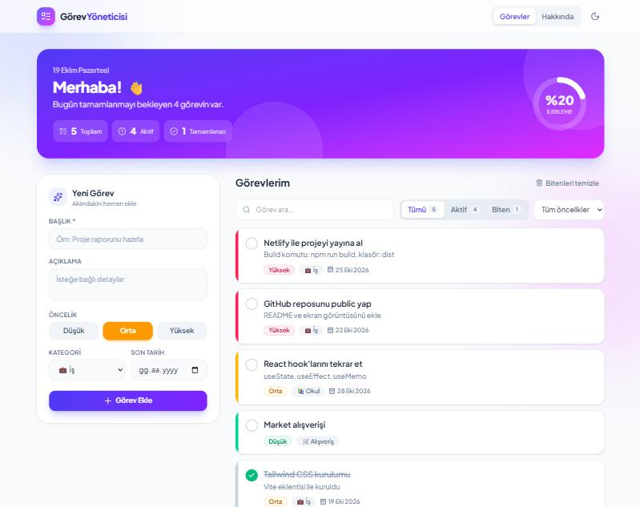

# ✅ Görev Yöneticisi

TNC Group **Online Staj Programı – Web Geliştirme** projesi kapsamında geliştirilmiş bir görev (TODO) yönetim uygulaması.
Görevler tarayıcının **LocalStorage** alanında saklanır; sayfa yenilense bile veriler kaybolmaz.

🔗 **Canlı Demo:** https://elif-gorev-yoneticisi.netlify.app



## Özellikler

| İşlem | Açıklama |
| --- | --- |
| **Ekle** | Başlık, açıklama, kategori, öncelik ve son tarih ile yeni görev oluşturma (form doğrulamalı) |
| **Listele** | Görevleri arama, duruma (Tümü / Aktif / Tamamlanan) ve önceliğe göre filtreleme |
| **Güncelle** | Düzenleme penceresi ile görevi değiştirme, tamamlandı olarak işaretleme |
| **Sil** | Onay penceresi ile görev silme, tamamlananları toplu temizleme |

Ek olarak: açık / koyu tema, ilerleme halkası, istatistikler, geciken ve bugünkü görev uyarısı, animasyonlar, mobil uyumlu tasarım.

## Kullanılan Teknolojiler

- [React 19](https://react.dev) + [TypeScript](https://www.typescriptlang.org)
- [Vite](https://vite.dev) (geliştirme sunucusu ve derleme)
- [Tailwind CSS 4](https://tailwindcss.com)
- [Lucide](https://lucide.dev) ikonları
- LocalStorage (veri saklama)
- [Netlify](https://www.netlify.com) (yayınlama)

## Klasör Yapısı

```
src/
├── components/     # Tekrar kullanılabilir arayüz parçaları
│   ├── Header.tsx
│   ├── TaskForm.tsx      # Ekle + Güncelle formu
│   ├── TaskList.tsx      # Listeleme
│   ├── TaskItem.tsx      # Tek görev kartı
│   ├── FilterBar.tsx     # Arama ve filtreler
│   ├── HeroBanner.tsx    # Karşılama alanı + istatistikler
│   └── Modal.tsx         # Düzenleme / silme pencereleri
├── pages/          # Sayfalar
│   ├── HomePage.tsx
│   └── AboutPage.tsx
├── interfaces/     # TypeScript tipleri
│   └── Task.ts
├── hooks/          # Özel React hook'ları
│   ├── useTasks.ts       # CRUD mantığı + LocalStorage
│   └── useTheme.ts       # Açık / koyu tema
├── App.tsx
├── main.tsx
└── index.css       # Tailwind girişi
```

## Kurulum ve Çalıştırma

```bash
git clone <repo-linki>
cd tnc-gorev-yoneticisi
npm install
npm run dev        # http://localhost:5173
npm run build      # üretim derlemesi (dist/)
```

## Netlify ile Yayınlama

1. Projeyi GitHub'a yükleyin.
2. Netlify → **Add new site → Import an existing project** → GitHub reposunu seçin.
3. Ayarlar `netlify.toml` dosyasından otomatik okunur (Build: `npm run build`, Publish: `dist`).
4. **Deploy** butonuna basın.
